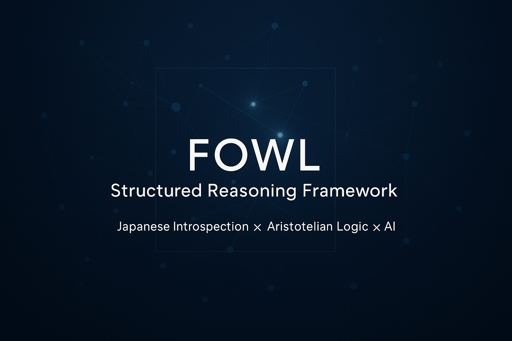

# **Leo’s Lyceum Vault**

<p align="center">
  
</p>

*A vault of FOWL (Fully Operational Wisdom and Logic) based on Reflective Computing and High-Context Intelligence.*

**Website:** [https://leo-nakayama.github.io/](https://leo-nakayama.github.io/)

Leo’s Lyceum Vault is an evolving knowledge ecosystem exploring how humans think, reflect, decide, and create meaning—integrating classical philosophy, modern AI reasoning, and high-context cultural analysis.

This Vault serves as both:

* a **public knowledge library**, and
* a **research notebook for developing new reasoning frameworks**, including FOWL (“Fully Operational Wisdom and Logic”), Reflective Computing, Synthetic Naikan, and High-Context Intelligence.

---

## 🌐 **Core Themes**

### **🧠 Reflective Computing**

A framework that treats self-reflection as a computational process. Includes:

* Synthetic Naikan
* Aristotelian Biodome
* Dialectic Modes
* Reflective Computing Manifesto

🔗 [https://leo-nakayama.github.io/reflective-computing/](https://leo-nakayama.github.io/reflective-computing/)

---

### **📜 High-Context Intelligence**

A long-form “mini-book” on Japanese high-context cognition, geopolitics, information hygiene, and cultural decision-making.

Includes Chapters 1–7 and analytical essays.

🔗 [https://leo-nakayama.github.io/high-context-intelligence/](https://leo-nakayama.github.io/high-context-intelligence/)

---

### **🧩 FOWL — A Structured Reasoning DSL**

A flexible mental-language system for analyzing strategy, politics, culture, and complex decisions.

Features:

* Observation Reports
* Political Dynamics modules
* TradeoffLens integrations
* Organizational reasoning tools

🔗 [https://leo-nakayama.github.io/projects/FOWL/](https://leo-nakayama.github.io/projects/FOWL/)

---

### **🎛 Projects (Systems & Tools)**

Prototypes and frameworks:

* DSL inference engine
* Reflective Exchange Authoring
* Relational Aesthetics consulting blueprints

🔗 [https://leo-nakayama.github.io/projects/](https://leo-nakayama.github.io/projects/)

---

### **📝 Essays**

Long-form writing on philosophy, geopolitics, AI, culture, and information hygiene.
Popular examples:

* **High-Context Information Hygiene**
* **AI as the New Kokutai**
* **How to Start FOWL Playbook Coding**

🔗 [https://leo-nakayama.github.io/essays/](https://leo-nakayama.github.io/essays/)

---

### 🇯🇵 **日本語セクション**

日本語版の考察・ノート・レポートがあります。

* 日本語ホーム
* 考察
* オブザベーションレポート
* ノート

🔗 [https://leo-nakayama.github.io/ja/](https://leo-nakayama.github.io/ja/)

---

## 📚 Repository Structure

```
docs/
  index.md
  essays/
  reflective-computing/
  high-context-intelligence/
  projects/
  notes/
  ja/
  meta/
mkdocs.yml
```

Built with **MkDocs Material**.

---

## 🪴 Purpose of the Vault

This Vault is a **digital garden**, not a fixed publication.
Documents evolve, cross-link, and grow into new conceptual branches.

The goals:

1. Create transparent thinking tools for modern complexity
2. Document reusable reasoning patterns
3. Unify Eastern high-context culture with Western logical structure
4. Build frameworks for AI-human co-reflection
5. Share methods openly for researchers, engineers, and practitioners

---

## 🔗 How to Explore

If you're new here, start with:

1. **High-Context Information Hygiene**
   → [https://leo-nakayama.github.io/essays/high-context-information-hygiene/](https://leo-nakayama.github.io/essays/high-context-information-hygiene/)

2. **Reflective Computing Overview**
   → [https://leo-nakayama.github.io/reflective-computing/](https://leo-nakayama.github.io/reflective-computing/)

3. **FOWL Project Page**
   → [https://leo-nakayama.github.io/projects/FOWL/](https://leo-nakayama.github.io/projects/FOWL/)

---

## 🤝 Contributing & Feedback

This is a personal research vault, but thoughtful feedback is welcome.
If you want to discuss Reflective Computing, FOWL, or cross-cultural intelligence, feel free to open issues or message via LinkedIn.

---

## 🔧 Build Instructions

To build the site locally:

```bash
pip install -r requirements.txt
mkdocs serve
```

Website builds via GitHub Actions and deploys to GitHub Pages.

---

## 📩 License

Unless otherwise noted, content is released under the **CC BY-NC-SA 4.0** license.

---

If you’d like, I can also generate:

* A **custom social preview image** (banner) designed exactly for GitHub
* A smaller “lite” README for your repo
* A **GitHub Topics list** you should tag (for discoverability)
