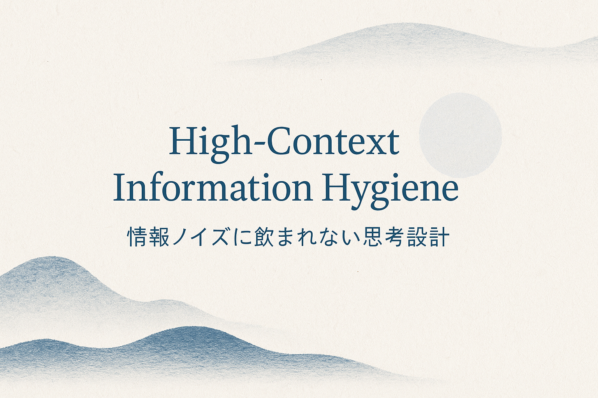

# High-Context Information Hygiene  

  

### Why Noise Corrupts Judgment — and How to Build a "Structural Data Only" Mindset  
*By Leo Nakayama, Lyceum Vault*  
*Published on https://leo-nakayama.github.io/*

## 1. Introduction
In moments of geopolitical tension, the biggest threat to human judgment is not fear — it is **information noise**.

Japan's current situation (2025), triggered by diplomatic friction between Tokyo and Beijing, demonstrates how rapidly public narratives can drift into emotional feedback loops. During such periods, the quality of information we consume directly determines the quality of our decisions.

This essay outlines a method called **High-Context Information Hygiene** — a systematic discipline for maintaining clarity, calmness, and structural awareness under stress.

The framework integrates:
- Japanese high-context communication patterns  
- Western low-context analysis methods  
- AI training principles  
- Finland's "Resilience and Warning Signal" system  
- FOWL (Fully Operational Wisdom and Logic) based on Reflective Computing

---

## 2. The Core Problem: Humans Are LLMs  
Human cognitive processing exhibits characteristics similar to large language models:

- We predict subsequent thoughts based on historical data  
- We update our worldview with new inputs  
- We generate erroneous outputs when trained on noisy or contradictory data  
- We stabilize when trained on clean, structured data

This establishes a fundamental relationship:

> **Bad data → bad thinking.  
> Good data → good thinking.**

This principle applies equally to AI systems and human cognition.

Yahoo! News, TV pundit shows, and algorithmically optimized engagement-driven articles function as **corrupted datasets** in the context of human information processing.

---

## 3. How Noise Creates Human Hallucinations  
### 3.1. AI Negative Reinforcement Loop in Human Form
Modern news platforms implement a click-through optimization algorithm:

User clicks → Platform shows more similar content → User clicks more frequently

This represents **negative reinforcement**, identical to how a poorly tuned reinforcement-learning model becomes distorted:

- If a model is rewarded for extreme output,  
  → it will produce increasingly extreme output  
- If a human is rewarded with emotional shock content,  
  → they will seek increasingly intense shock content

The consequences include:
- Fear amplification  
- Anger amplification  
- Loss of structural understanding  
- Collapse of diplomatic nuance  
- False perception of "public opinion consensus"

This mechanism explains why high-engagement news platforms are addictive and destructive to judgment quality.

### 3.2. Cognitive Consequence: Structural Amnesia  
Excessive noise consumption causes the loss of:

- Long-horizon pattern recognition  
- Diplomatic structure awareness  
- Multi-layer causality understanding  
- Timeline consistency  
- Context-awareness

In AI research, this phenomenon is referred to as **pattern collapse**.

---

## 4. The Solution: High-Context Information Hygiene
To maintain decision quality under stress, humans must adopt an **information diet** comparable to requirements for high-performing AI systems.

### Core Principles
1. **Limit low-quality, high-noise sources**  
2. **Consume only structural data, not emotional data**  
3. **Monitor signals, not stories**  
4. **Separate event-level news from trend-level shifts**  
5. **Document a fixed set of "Trigger Points"**  
6. **Share the same structure with family members** (to prevent narrative fragmentation)

### Structural Data Only Sources  
The following sources provide signal rather than noise:

#### China  
- Ministry of Foreign Affairs (MFA)  
- Xinhua  
- Global Times (narrative barometer)

#### United States  
- U.S. State Department  
- The White House press office  
- U.S. Embassy Japan  
- Congressional Research Service (CRS)

#### Think Tanks (signal generators)  
- CSIS (Center for Strategic and International Studies)  
- RAND Corporation  
- Carnegie Endowment for International Peace  
- Council on Foreign Relations (CFR)  
- Brookings Institution  
- Hoover Institution  
- American Enterprise Institute (AEI)

#### Markets (objective indicators)  
- USD/JPY exchange rate movement  
- Credit Default Swap (CDS) spreads  
- Japanese Government Bond (JGB) yields  
- Global risk indices (VIX)

**All content outside this list should be classified as noise.**

---

## 5. Why High-Context Cultures Are Vulnerable to Noise  
Japan operates as one of the world's strongest high-context cultures, characterized by:

- Shared assumptions  
- Implicit norms  
- Intuitive atmosphere reading ("空気" / kuuki)  
- Collective emotional synchronization

In stable conditions, high-context culture demonstrates high efficiency.

However, during crisis periods, it becomes **structurally vulnerable** because:

> **Atmosphere supersedes information quality as the dominant decision factor.**

This vulnerability manifests as:

- Misunderstanding of international reactions  
- Overconfidence in domestic "common sense"  
- Inability to perceive external interpretations of Japanese actions  
- Rapid drift into emotional majoritarianism  
- Censorship through social pressure rather than legal mechanisms

These dynamics were clearly observable following the Takaichi incident.

---

## 6. Minimizing Human Hallucination: A Practical Protocol  
The following protocol represents a simplified implementation of FOWL's structural disciplines:

### Daily (5 minutes)
- Check China Ministry of Foreign Affairs statements  
- Check U.S. State Department announcements  
- Monitor USD/JPY exchange rate  
- Verify whether any think tank issued a new Japan-related analysis

### Weekly (10 minutes)
- Update the Trigger Sheet (tracking Stage B1 → B2 → B3 progression)  
- Review diplomatic terminology shifts  
- Review domestic narrative shifts (e.g., normalization of "anti-Takaichi = anti-Japan" framing)

### Never Execute
- Scroll Yahoo! News  
- Read unverified social media reactions  
- Follow low-quality commentators  
- Read comment sections  
- Chase anger-inducing news articles

As with AI systems:  
**garbage in → garbage out**

---

## 7. Conclusion  
Structural information hygiene is not information avoidance — it is **systematic consumption of the right data in the right way**.

In an environment of accelerating geopolitical tension, the ability to maintain cognitive clarity is no longer optional. It is a **critical operational skill**.

This essay is part of an emerging series:

**High-Context Intelligence Framework**  
Integrating Japanese cultural logic, Western analytical logic, and AI-level cognitive hygiene into a unified operational model.

**FOWL🦆Project: [High-Context Communication and Crisis Model (HCCM)](../high-context-intelligence/index.md)**

Additional chapters will be published to the Lyceum Vault.