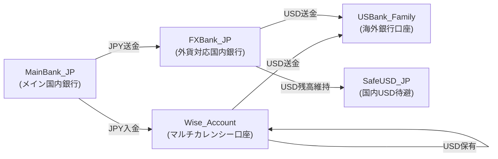

# 🌐 **海外退避／移住のための金融ルート設計テンプレート（Vault公開用）**

*Version 1.0 — Variable-Based Template / Public Safe Edition*

---

## 1. 目的

日本国内の金融インフラから海外（例：米国）への資金移動を、
**安全・高速・冗長化（複数ルート化）**するためのテンプレートです。

読者の環境に合わせて、以下の「変数名」を自分の銀行・口座に置き換えてください。

---

## 2. 変数定義（読者が自分の環境に合わせて上書きしてください）

```md
- `MainBank_JP`
  - 給与振込などの日常のメイン国内銀行（例：三井住友、みずほ、りそな）
- `FXBank_JP`
  - 外貨預金が可能な国内銀行（例：Sony銀行、住信SBIネット銀行）
- `Wise_Account`
  - Wise マルチカレンシー口座（実名のままでOK）
- `USBank_Family`
  - 海外側の受取銀行口座（家族名義でも可）
- `SafeUSD_JP`
  - 国内に残しておくUSD待避用口座（通常は `FXBank_JP` のUSD残高）
```

---

## 3. 金融退避ルート A〜D（役割ベース）

### **Route A: MainBank_JP → Wise_Account → USD → USBank_Family**

**最速・最も実用的な少額〜中規模向けルート**

手順：

1. `MainBank_JP` から Wise に JPY 入金
2. Wise 内で JPY → USD に両替
3. Wise → `USBank_Family` へ USD 送金（ACH / Wire）

用途：

* 海外移住直前
* 緊急退避（スピード重要）
* 少額〜中額（〜100万円程度）

---

### **Route B: MainBank_JP → FXBank_JP → USBank_Family（銀行外貨送金）**

**銀行 → 銀行の安定ルート（冗長性の要）**

手順：

1. `MainBank_JP` → `FXBank_JP` に JPY 送金
2. `FXBank_JP` 内で JPY → USD 両替
3. `FXBank_JP` → `USBank_Family` へ海外送金（SWIFT / Wire）

用途：

* Wise が障害のときのバックアップ
* 大口送金に向く（100万円〜）
* 日本→海外の“正式な”送金ルート

---

### **Route C: MainBank_JP → Wise_Account（USD保有）**

**Wise 内に USD をためておくヘッジ用ルート**

手順：

1. `MainBank_JP` → Wise に JPY 入金
2. Wise 内で JPY → USD 両替
3. Wise 口座内に USD を保有

用途：

* 為替が不安なときの短期ヘッジ
* 渡航前に「即送金する準備」を作る

---

### **Route D: FXBank_JP → SafeUSD_JP（国内USD待避）**

**日本国内に USD を残す最後のバックアップ**

手順：

* `FXBank_JP` の USD 残高を国内退避資産として維持
* 必要に応じて円転または海外送金に使用可能

用途：

* 日本の銀行／Wise どちらかが障害でも USD を保持
* 最悪時の「国内避難所」資産

---

## 4. 退避ルートの構造図（Mermaid / 変数ベース）



---

## 5. Micro-Playbook（FOWL的・実務向けチェックリスト）

### **🎯 Goal：いつでも24時間以内に海外へ資金退避できる状態を維持する**

---

### **[Monthly] 毎月1回の安定性チェック**

* [ ] Wise へ少額入金（1,000〜3,000円）して UI/仕様変更チェック
* [ ] Wise の送金上限（Annual / per transfer）を確認
* [ ] `FXBank_JP` の外貨残高・外貨→外貨手数料を再確認
* [ ] Exchange rate の急変動が続く場合、ルートCのUSD保有を増減

---

### **[Quarterly] 四半期ごとの“ルート健全性”チェック**

* [ ] Route A: Wise → `USBank_Family` へ小額（10〜20 USD）テスト送金
* [ ] Route B: `FXBank_JP` → `USBank_Family` の海外送金を小額テスト
* [ ] Wise のアプリ更新後の UI/仕様変化をキャプチャして Vault に保存
* [ ] `USBank_Family` の入金通知ログを確認（手数料/着金速度）

---

### **[Pre-Move] 渡航が近いとき**

* [ ] Route A で生活費 1〜3ヶ月分の USD を移しておく
* [ ] Route C に USD を一定額保管（Wise内の高速予備資金）
* [ ] Route D (`SafeUSD_JP`) に国内USDを残す
* [ ] 送金に必要な情報（SWIFT, routing, intermediary）を Vault に保存
* [ ] エビデンス（スクショ・手数料情報）も合わせて保存

---

### **[Emergency Mode] 緊急退避時（24時間以内）**

* Step 1: Route A でなるべく大きな額を Wise → 海外口座へ
* Step 2: Route C の USD を即送金
* Step 3: Route B（銀行送金）をセットして出国
* Step 4: Route D は国内に残し、情勢安定後に調整

---

## 6. 注意事項（経験則に基づく一般的アドバイス）

* 「銀行名は毎年仕様が変わる」ため、**構造だけを共有するほうが安全**
* Wise の仕様も年に数回変わるため、**Monthly Test は必須**
* 海外側銀行は名義・住所の扱いが厳格なので、**小額テスト送金が生命線**
* 海外送金の中継銀行（Intermediary Bank）は必ず発生するわけではない
* 為替ヘッジは “日本側USD + Wise側USD + 海外側USD” の三層構造が最強

---
