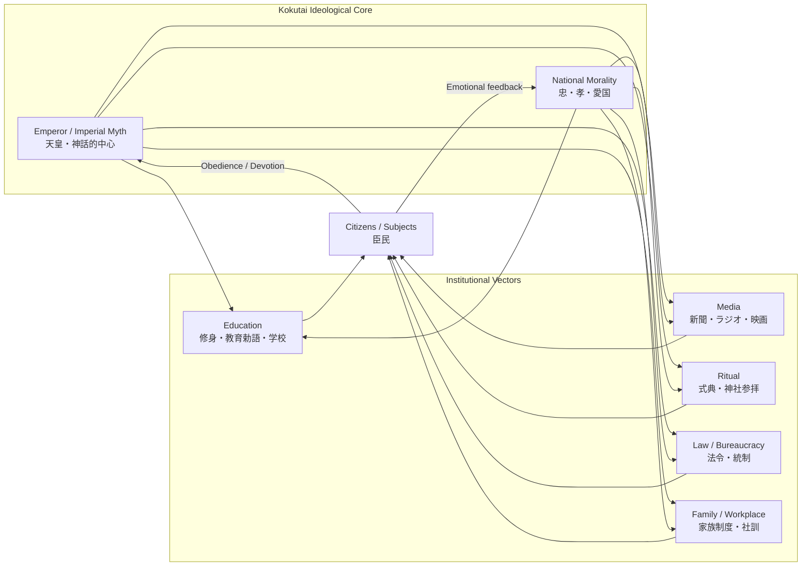
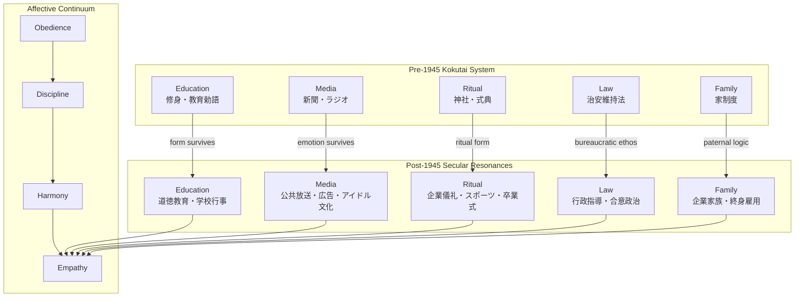

## 🏛️ 1. Basic Meaning

**Kokutai (国体)** literally means **“national body”** or **“body of the nation.”**
But unlike a mere constitutional structure (*seitai*, 政体), kokutai referred to the **metaphysical essence of Japan’s polity** — a conception of the nation as a *living moral organism* centered on the **Emperor (天皇)**.

* **Koku (国)** = nation, realm, community of people
* **Tai (体)** = body, form, substance, or system

In Western terms, it resembles an attempt to fuse *Rousseau’s social body*, *Hegel’s ethical state (Sittlichkeit)*, and *Christian organic metaphors of the body of Christ*—but without secular separation between the political and the sacred.

---

## 🧩 2. Historical Context

* The term emerged in the **late Edo and early Meiji periods (19th century)** as Japan sought to modernize while preserving its identity.
* The **Meiji Constitution (1889)** formally defined Japan as a constitutional monarchy, but the ideological foundation was **kokutai**—the Emperor as the eternal, sacred center of the Japanese nation.
* By contrast, **seitai (政体)** referred to the *governmental form* (a changeable system of administration).

  > The Meiji Constitution was “modern,” but kokutai claimed to be *timeless.*

So, Japan could adopt Western technologies and institutions (parliament, law codes, railways), while maintaining the unbroken **“national essence”**—a metaphysical continuity from mythic antiquity.

---

## 🧠 3. Philosophical Dimensions

| Conceptual Axis    | Kokutai’s Position                                                         | Western Analogy                                           |
| ------------------ | -------------------------------------------------------------------------- | --------------------------------------------------------- |
| Ontology           | The nation is a moral organism with divine ancestry                        | Hegel’s *Volksgeist* or medieval *corpus mysticum*        |
| Epistemology       | Truth arises from moral intuition and imperial virtue, not rational debate | Romantic conservatism (Herder, de Maistre)                |
| Ethics             | Loyalty (忠) and filial piety (孝) as public virtues                         | Civic virtue merged with religious devotion               |
| Political Theology | The Emperor as both sovereign and priest                                   | Theocratic monarchism / “King’s Two Bodies” (Kantorowicz) |

In short, **kokutai is the metaphysical justification for political authority**, grounded in lineage and morality rather than social contract or democratic consent.

---

## 📚 4. Institutionalization in Education

* The **Imperial Rescript on Education (1890)** codified kokutai ethics for everyday life.
  Students memorized it as moral scripture.
* The **textbook system** and the **Ministry of Education’s teaching guides** (“The True Meaning of the National Polity,” 1937) reinterpreted it in increasingly emotional, quasi-religious terms.
* The goal was to make each citizen feel that their **personal virtue was participation in the divine life of the nation.**

Thus, education became the ritual practice of kokutai.

---

## ⚙️ 5. Political and Emotional Function

By the 1930s, kokutai evolved from a constitutional philosophy into a **mass emotional doctrine**:

* It sacralized obedience to the Emperor as moral fulfillment.
* It equated dissent with spiritual pollution.
* It justified both domestic conformity and imperial expansion as moral duties.

In modern terms, **kokutai functioned as a totalizing “civil religion.”**
It unified politics, morality, and emotion under a single symbolic body—the Emperor’s.

---

## 🔍 6. Comparative Perspective

| Dimension             | Kokutai                                      | Western Parallel                                           |
| --------------------- | -------------------------------------------- | ---------------------------------------------------------- |
| Sacred foundation     | Emperor’s divine descent from Amaterasu      | Divine Right of Kings, but racialized and mythic           |
| View of the state     | Organic, eternal, paternal                   | Hobbes’ Leviathan (as living body) but with filial loyalty |
| Education’s role      | Moral cultivation of obedient subjects       | Rousseau’s *Émile* inverted—education for devotion         |
| Modernization paradox | Adopt Western form, preserve Japanese spirit | Similar to Romantic nationalism (Fichte, Herder)           |

So while the *form* of Japan modernized, the *spirit* (kokutai) remained premodern, serving as a theological anchor against “moral disintegration.”

---

## 🕊️ 7. Aftermath and Legacy

After Japan’s defeat in 1945, the **Allied Occupation (GHQ)** banned use of the term *kokutai* as a fascist ideology.
However, the emotional residues of kokutai — filial loyalty, group harmony, and the moralization of obedience — continued to influence postwar corporate and educational culture.

In this sense, kokutai survives not as doctrine but as *affective structure*:

> a background rhythm of how “Japan” imagines itself as a moral whole.

---

## 💬 Condensed Definition (for Western readers)

> **Kokutai (国体)** was the Japanese modern state’s *metaphysical constitution*—the idea that the nation is a sacred moral body centered on the Emperor, whose divine lineage guarantees both political legitimacy and moral order.
> It functioned simultaneously as theology, pedagogy, and propaganda—an emotional grammar for belonging that made loyalty indistinguishable from virtue.


---

## 🧭 Conceptual Genealogy of Kokutai — from Ethics to Civil Religion

### 1️⃣ Overview Narrative

The evolution of **kokutai** can be seen as a continuous *translation* of older ethical and cosmological frameworks into the language of statehood and collective emotion.

| Stage                                        | Core Source | Transformation                                     | Function                               |
| -------------------------------------------- | ----------- | -------------------------------------------------- | -------------------------------------- |
| **Confucian / Neo-Confucian (Edo)**          | 家族倫理・忠孝・秩序  | Household morality → public ethics                 | Personal virtue = social harmony       |
| **Restoration Ideology (Bakumatsu – Meiji)** | 皇統・神話・国学    | Mythic descent + Confucian loyalty → national myth | Legitimation of imperial restoration   |
| **State Shintō System (Meiji)**              | 国家儀礼・教育勅語   | Moral law → divine law                             | Institutional sacralization            |
| **Kokutai Doctrine (1930s)**                 | 文部省『国体の本義』等 | Sacred law → emotional creed                       | Total mobilization & identity religion |
| **Post-1945 Residue**                        | 終戦詔書・企業倫理   | Kokutai → cultural affect                          | Harmony (和) as secularized loyalty     |

So the vector moves **from ethical → political → theological → affective.**

---

### 2️⃣ Mermaid Flowchart

```mermaid
flowchart TD
    A[Confucian / Neo-Confucian Ethics<br>忠・孝・家族秩序] --> B[Restoration Ideology<br>国学・皇統・尊王思想]
    B --> C[State Shintō System<br>教育勅語・国家儀礼]
    C --> D[Kokutai Doctrine (1930s)<br>国体の本義・臣民の道]
    D --> E[Wartime Civil Religion<br>総動員・感情統制]
    E --> F[Post-war Residue<br>文化的コクタイ＝和・集団調和]

    subgraph Metaphysical Shift
        direction LR
        X1[Ethical] --> X2[Political] --> X3[Theological] --> X4[Affective]
    end
    F -.perceptual echo.-> X4
```

**Reading Guide**

* **Vertical flow (A→F)** = Historical sequence (幕末→明治→昭和→戦後)
* **Lower subgraph** = Ontological deepening: how *virtue* became *faith* became *feeling*
* The dotted arrow shows how the postwar ethos (“wa / harmony”) carries faint resonance of kokutai as an affective form.

---

### 3️⃣ Reflective Commentary

* **Material cause:** educational & ritual infrastructure.
* **Formal cause:** fixed moral syntax (“loyalty–filial piety – purity”).
* **Efficient cause:** Meiji state apparatus → Ministry of Education → wartime propaganda.
* **Final cause:** preservation of a sacred continuity between Emperor, nation, and people.

Post-1945, the *telos* shifted from divine unity to social cohesion—but the underlying form (paternal harmony as moral good) persisted.

---

## 🧩 Disciplinary Vectors of Kokutai — The Operational Mechanics of a Moral Organism

### 1️⃣ Overview Narrative

By the 1930s, kokutai was no longer just a philosophical idea but an **integrated moral-bureaucratic system**.
Each domain—education, media, ritual, law—functioned as an *artery* carrying kokutai’s moral blood through the social body.

| Domain                 | Function                          | Typical Instruments | Emotional Output                  |
| ---------------------- | --------------------------------- | ------------------- | --------------------------------- |
| **Education**          | Internalize hierarchy and loyalty | 教育勅語・修身教科書・唱歌・朝礼    | Filial devotion / moral duty      |
| **Media**              | Reproduce unity through emotion   | 新聞・ラジオ・ニュース映画・絵葉書   | Shared affect / patriotic empathy |
| **Ritual**             | Make ideology bodily and visible  | 神社参拝・式典・国旗掲揚・修身朗唱   | Sacred participation / belonging  |
| **Law / Bureaucracy**  | Codify obedience as virtue        | 治安維持法・学校令・出版統制      | Fear + moralized compliance       |
| **Family / Workplace** | Miniaturize national hierarchy    | 家長制・社訓・終身雇用         | Familialized loyalty / harmony    |

Each vector reinforced the others:
education provided **language**, media provided **emotion**, ritual provided **embodiment**, law provided **coercion**, and family provided **continuity**.

---

### 2️⃣ Mermaid Diagram — *Disciplinary Vectors Flowchart*



**Reading Guide**

* The **Ideological Core** (Emperor + National Morality) radiates outward.
* Each **Institutional Vector** translates the abstract ethos into concrete practices.
* The **Citizen** node closes the loop, feeding back emotional confirmation (“I belong; I serve”).
* The result is a **self-reinforcing moral circuit**—what we might call an *Aristotelian organism of obedience*.

---

### 3️⃣ Philosophical Interpretation (Four Causes mapping)

| Cause               | Manifestation in the System                                        |
| ------------------- | ------------------------------------------------------------------ |
| **Material Cause**  | School buildings, radio towers, flags, rituals, printed books      |
| **Formal Cause**    | Moral scripts (忠・孝・愛国), institutional routines                     |
| **Efficient Cause** | Bureaucrats, teachers, priests, journalists, family heads          |
| **Final Cause**     | Emotional unity under the Emperor — the felt continuity of kokutai |

Thus, kokutai functioned as a *total semiotic ecosystem*:
every message, gesture, and policy mirrored the same moral geometry.

---

### 4️⃣ Reflective Commentary

> Kokutai was less an ideology to be believed than a **form to be inhabited**.
> Through repetition, it made emotion itself political and turned the act of *feeling together* into the highest moral good.

This is why, even after 1945, when its theological content was purged, its **formal rhythm**—collective emotion, ritual harmony, institutional paternalism—remained recognizable in corporate, educational, and bureaucratic culture.

---

## 🕊️ Postwar Resonances of Kokutai

**Subtitle:** From Sacred Obedience to Secular Harmony

### 1️⃣ Overview Narrative

After 1945, the word *kokutai* was banned, the Emperor renounced divinity, and Japan adopted a democratic constitution.
Yet the **habitus** of kokutai — its moral posture, affective tone, and relational logic — quietly survived.
It migrated into new contexts: the school, the company, the bureaucracy, the media, and even popular culture.

| Pre-1945 Vector      | Post-1945 Form                                         | Secular Function                      | Emotional Tone                 |
| -------------------- | ------------------------------------------------------ | ------------------------------------- | ------------------------------ |
| **Education**        | National curriculum, moral education (*dōtoku kyōiku*) | Social cohesion, respect for order    | “Cooperation,” not “obedience” |
| **Media**            | NHK, advertising, national sentimentality              | Shared empathy, emotional nationalism | “Warm unity”                   |
| **Ritual**           | Corporate ceremonies, sports events, graduation rites  | Civic belonging without theology      | “We-feeling”                   |
| **Law/Bureaucracy**  | Administrative guidance, consensus politics            | Order through soft governance         | “Harmony over conflict”        |
| **Family/Workplace** | Lifetime employment, company paternalism               | Group identity as moral comfort       | “Loyalty as gratitude”         |

So, kokutai was not destroyed — it **molted**.
Its body died, but its rhythm kept beating inside new shells.

---

### 2️⃣ Mermaid Diagram — *Postwar Resonances of Kokutai*



**Reading Guide**

* The **Prewar → Postwar** arrows show *formal survivals* (教育→道徳教育 etc.).
* The **Affective Continuum** illustrates how emotional tone transformed from obedience → empathy.
* The new telos is no longer *divine unity* but *social smoothness* — harmony as secular virtue.

---

### 3️⃣ Philosophical Mapping (Four Causes Revisited)

| Cause               | Pre-1945 Form                  | Post-1945 Resonance                    |
| ------------------- | ------------------------------ | -------------------------------------- |
| **Material Cause**  | Schools, shrines, factories    | Schools, companies, broadcast networks |
| **Formal Cause**    | Hierarchical morality          | Harmony and consensus scripts          |
| **Efficient Cause** | Bureaucrats, priests, teachers | Managers, civil servants, educators    |
| **Final Cause**     | Obedience to the Emperor       | Emotional stability and social order   |

➡ **Telos shift:** *From vertical unity to horizontal empathy*
But the **Formal structure**—ritual repetition, emotional synchronization—remains intact.

---

### 4️⃣ Reflective Commentary

> The Japanese postwar self became a mirror without its god:
> still reflecting others, still seeking harmony, but now without an absolute center.

In this sense, **kokutai did not vanish; it dissolved into culture.**
Where prewar kokutai demanded sacrifice, postwar kokutai offers comfort.
Where once there was sacred hierarchy, now there is affective consensus — the same rhythm, slowed and softened.

This is the enduring paradox of modern Japan:
**emancipation from ideology achieved through the continuity of form.**

---
